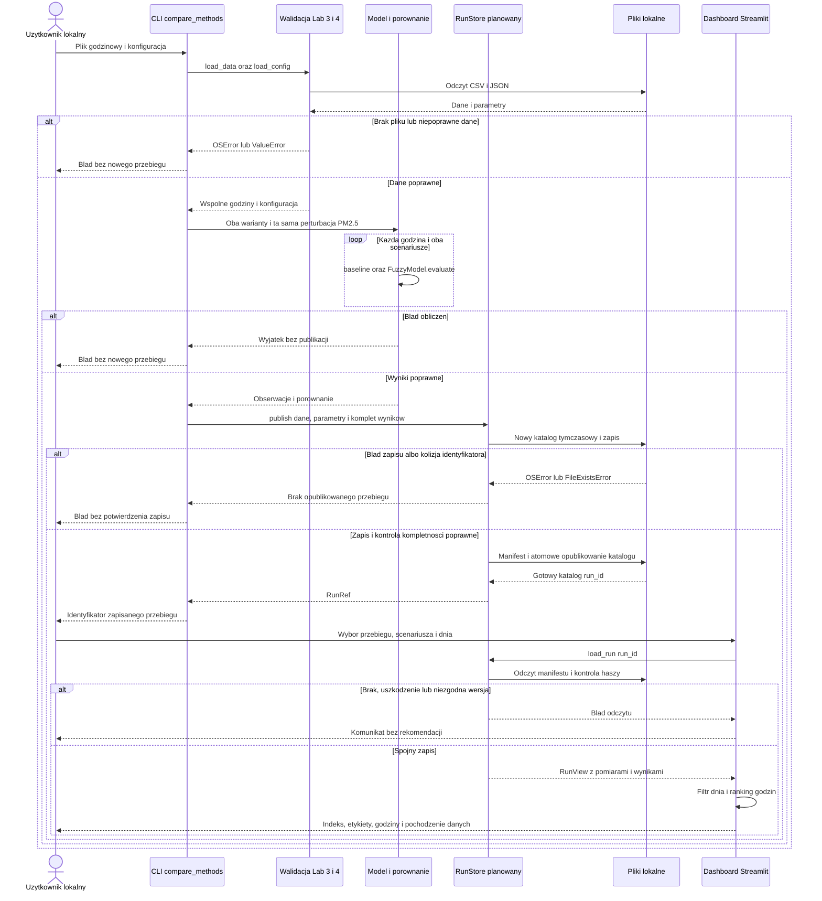
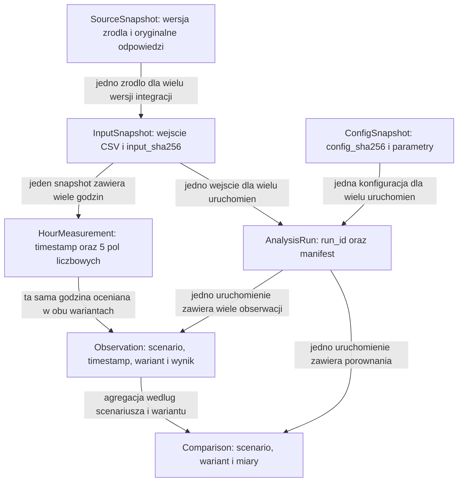

# Architektura AeroRun

Projekt obejmuje lokalny moduł analityczny CLI i dashboard Streamlit dla R5:
oceny warunków i wskazania najlepiej ocenionych godzin wybranego dnia.
Podstawą jest wersja Lab 3–4 z rzeczywistymi pomiarami GIOŚ i reanalizą ERA5
Open-Meteo. Nazwy modułów odnoszą się do tej wersji po integracji części zespołu.
Lab 5 opisuje projekt zmian; nie implementuje nowych funkcji ani magazynu.

## Granice i stan rozwiązania

Użytkownik działa lokalnie i ma dostęp do plików projektu. GIOŚ i Open-Meteo
są systemami zewnętrznymi. Własny system odpowiada za zachowanie odpowiedzi,
normalizację czasu, integrację, ocenę, zapis i prezentację. Nie odpowiada za
działanie stacji, weryfikację pomiarów przez GIOŚ ani jakość reanalizy ERA5.
Odtworzenie obliczeń na zapisanej próbce nie wymaga połączenia z API.

Nie ma logowania, panelu administracyjnego, zdalnego API ani bazy SQL, ponieważ
bieżący zakres nie wymaga kont użytkowników, współbieżności ani wspólnej historii.
Nie powstaje prognoza przyszłego PM. R4 o korelacji/regresji pozostaje osobnym,
niezrealizowanym w tym przypadku użycia wymaganiem. Etykiety R5 są wynikiem
przyjętych reguł, bez potwierdzenia bezpieczeństwa zdrowotnego treningu.

| Element | Stan | Odpowiedzialność |
|---|---|---|
| Zapisane odpowiedzi GIOŚ i ERA5 oraz provenance.json | Istnieje w wersji danych Lab 3–4 | Źródło, stacja, jednostki, czas pobrania i hashe |
| scripts/prepare_data.py i integracja.py | Istnieją | Kontrola, ujednolicenie czasu i integracja CSV |
| scripts/lab4_air.py, lab4_data.py i audyty | Istnieją | Kontrola pomiarów, braków, dat i kompletności |
| scripts/fuzzy_model.py | Istnieje | Reguły progowe i wnioskowanie Mamdaniego |
| scripts/compare_methods.py | Istnieje | Oba warianty, perturbacja PM2.5 i próba wrażliwości |
| results/lab4/ oraz sensitivity/ | Istnieją | Jeden zapis wyników i parametrów; kolejne uruchomienie może go nadpisać |
| app_lab4.py | Istnieje | Odczyt wyników, scenariusz, dzień, wykres, etykiety i ranking godzin |
| RunStore, RunRef, RunView i manifest.json | Planowane | Niezmienny zapis uruchomień, identyfikator, spójny odczyt |
| Wybór historycznego run_id i daty utworzenia w dashboardzie | Planowane | Jawny wybór przebiegu i pochodzenia danych |
| Walidacja minimalnej próby 48 godzin przed obliczeniami | Planowana | Domknięcie kryterium R1, którego load_data obecnie nie egzekwuje |

## UC-01 Przygotowanie oceny i wybór godzin

| Element | Ustalenie |
|---|---|
| Aktor i cel | Lokalny użytkownik chce porównać oceny i wybrać najlepiej ocenione godziny konkretnego dnia |
| Wymaganie | R5; warunki danych wynikają z R1, R2 i R3 |
| Wejście | data/processed/aerorun_dane.csv, config/lab4.json; następnie run_id, scenariusz i lokalna data w dashboardzie |
| Warunek rozpoczęcia | Zintegrowane dane jednej stacji, co najmniej 48 kolejnych pełnych godzin, komplet pól, poprawny czas i konfiguracja |
| Przebieg poprawny | CLI wczytuje i waliduje dane, oblicza oba warianty i scenariusze, zapisuje pełne uruchomienie; użytkownik w dashboardzie wybiera zapis, scenariusz i dzień; system pokazuje indeksy, etykiety i ranking |
| Wynik | Identyfikator zapisu, zakres pomiarów, stacja i źródła, parametry, indeksy 0–100 i do trzech godzin TRENUJ wybranego dnia |
| Brak danych | Komunikat wskazujący brak pliku, pola lub godziny; brak nowego opublikowanego wyniku |
| Brak dnia | Komunikat o niedostępnym dniu; bez przejścia na inny dzień |
| Brak godzin TRENUJ | Jawny komunikat, bez sztucznego wskazania godziny |
| Błąd obliczeń lub zapisu | Brak potwierdzenia zapisu; wcześniejsze uruchomienia pozostają dostępne |
| Błąd odczytu wyników | Komunikat bez rankingu i bez prezentacji częściowej tabeli jako kompletnego przebiegu |
| Kryterium odbioru | Znana próbka zachowuje wyniki Lab 4, błędne wejście nie tworzy opublikowanego przebiegu, błąd zapisu nie narusza poprzednich wyników |

CLI i Streamlit są dwoma lokalnymi interfejsami tego przypadku użycia.
Projekt nie zakłada istniejącego przycisku obliczeń w dashboardzie. W obecnym
app_lab4.py można wybrać tylko scenariusz i dzień zapisu results/lab4/.

## Sekwencja UML

Diagram przedstawia docelową sekwencję; RunStore, wybór run_id i walidacja
manifestu są planowane. Wywołania walidacji i obliczeń wykorzystują istniejący kod.

## Przepływ i model danych

```mermaid
flowchart LR
    G["GIOS: godzinowe PM2.5 i PM10"] -->|"JSON, CET i metadane"| R["Zapisane odpowiedzi i provenance.json"]
    O["Open-Meteo: reanaliza ERA5"] -->|"JSON, UTC i jednostki"| R
    R -->|"gios_pomiary.csv i open_meteo_pogoda.csv"| P["Lab 3: czas, kontrola i integracja"]
    P -->|"aerorun_dane.csv, 1 wiersz na godzine"| V["Lab 4: walidacja danych i konfiguracji"]
    K["config/lab4.json"] --> V
    V -->|"lista poprawnych godzin i parametry"| A["Reguly progowe i Mamdani"]
    A -->|"obserwacje, porownanie, kontrole"| S["Planowany RunStore: niezmienny run_id"]
    R -->|"wersja zrodla i czas pobrania"| S
    S -->|"RunView, manifest i hasze"| D["Dashboard: scenariusz i dzien"]
    D -->|"indeks 0-100, etykieta, godziny i daty"| U["Uzytkownik"]
    V -->|"blad danych"| E["Komunikat bez nowego wyniku"]
    A -->|"blad obliczen"| E
    S -->|"blad zapisu lub odczytu"| E
```

Jeden rekord wejścia oznacza jedną godzinę jednej stacji. Pola to timestamp
z offsetem oraz pm25 i pm10 w µg/m³, temperature_2m w °C, wind_speed_10m w km/h
i precipitation w mm sumy godzinowej. Jeden rekord observations.csv oznacza
godzinę i metodę w scenariuszu; wynik perturbacji mieści się w tym samym wierszu.
Jedna godzina ma dwa wyniki, więc 72 godziny tworzą 144 wiersze na scenariusz.

Klucz godziny jest jednoznaczny w UTC. Klucz wyniku to run_id, scenario, timestamp,
wariant. Klucz agregacji to run_id, scenario, wariant. Nie są to klucze SQL;
ich kontrolę wykonuje planowana walidacja plików.

Istniejący magazyn to results/lab4/ i sensitivity/. Docelowo każdy przebieg ma
osobny results/runs/<run_id>/ z kopiami input.csv, config.json, provenance.json,
dotychczasowymi plikami wyników i manifest.json. Manifest wiąże run_id z SHA-256
wejścia, konfiguracji, kodem, wersją źródła i kompletem plików. Nie zmienia się
schematów CSV Lab 4. Szczegóły typów, relacji i ścieżek zawiera
[model danych](lab5/data-model.md).

## Kontrakt i obsługa błędów

Istniejąca granica to FuzzyModel(cfg).evaluate(row) -> wynik z score, label
i r_bad, r_middle, r_good. Dane z load_data zawierają liczby float we wskazanych
jednostkach. Brak pola lub niepoprawny pomiar powoduje ValueError. Błąd nie jest
przekazywany jako indeks 0. Model nie zapisuje plików i nie weryfikuje czasu.

Planowany prepare_run zwraca RunRef dopiero po pełnym zapisie. Planowany
load_run zwraca RunView dopiero po kontroli schematu i haszy. To granice funkcji
w procesie lokalnym, bez endpointów HTTP. Pełny kontrakt z błędami i kryteriami
odbioru zawiera [opis interfejsów](lab5/contracts.md).

## Wybór technologii i wynik Lab 4

Pozostają Python, Pandas, scikit-fuzzy oraz Streamlit, bo są już używane w Lab 3–4
i odpowiadają lokalnemu przepływowi plików. Nie jest potrzebna nowa biblioteka
obliczeniowa, ORM ani serwer bazy. Mermaid i Markdown umożliwiają wersjonowanie
diagramów razem z opisem. Zapis CSV/JSON i alternatywę SQLite rozstrzyga
[ADR-001](decisions/001-storage.md).

Dla rzeczywistych danych Lab 4 średnia zmiana indeksu wynosi 0.555556 pkt dla
baseline i 0.422230 pkt dla metody rozmytej, około 24% mniej. Zmian etykiety jest
jednak 1 i 4. W próbie wrażliwości średnie wynoszą 0 oraz 0.040723 pkt, więc
przewaga stabilności nie utrzymuje się. Architektura zachowuje oba warianty,
parametry i oba scenariusze; nie uznaje wyniku za dowód trafności zdrowotnej.
Źródłem wyników jest docs/experiment.md i results/lab4/.

## Zmiany do realizacji i przegląd

| Zmiana | Właściciel | Zgłoszenie |
|---|---|---|
| Niezmienne snapshoty odpowiedzi i metadanych | Dawid Jopek | [L5-01](issues/lab5-01-source-snapshots.md) |
| Wersjonowany zapis i kontrola spójności danych | Kacper Dąbek | [L5-02](issues/lab5-02-run-storage.md) |
| Koordynator analizy z odroczoną publikacją | Maksym Łazowski | [L5-03](issues/lab5-03-analysis-contract.md) |
| Wybór przebiegu i jawne daty w dashboardzie | Kornel Łazowski | [L5-04](issues/lab5-04-dashboard-history.md) |
| Przegląd przez innych członków zespołu | Kacper Dąbek, z podziałem obszarów w zgłoszeniu | [L5-05](issues/lab5-05-review.md) |
