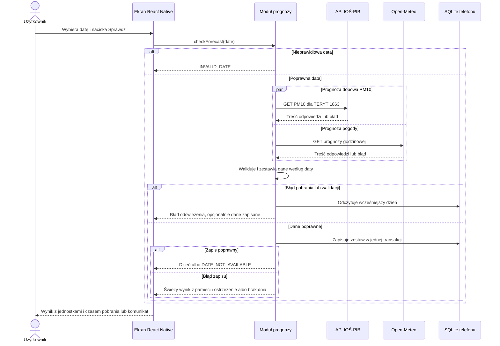
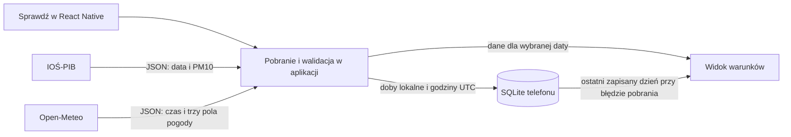

# Architektura AeroRun — Lab 5

## Granice i odpowiedzialności

AeroRun to aplikacja mobilna React Native (TypeScript) dla osób planujących trening w Rzeszowie. Po naciśnięciu **Sprawdź** telefon pobiera dobową prognozę PM10 z IOŚ-PIB, publikowaną także przez GIOŚ, oraz godzinową temperaturę, opady i wiatr z Open-Meteo. React Native łączy się bezpośrednio z publicznymi API przez HTTPS. SQLite działa lokalnie na telefonie i przechowuje ostatni poprawnie pobrany zestaw.

| Element | Stan i odpowiedzialność |
|---|---|
| Źródła zewnętrzne | [API z Lab 2](data.md) dla miasta Rzeszów (TERYT 1863) i współrzędnych 50.0413, 21.999. |
| Przetwarzanie Lab 3 | Istniejący [skrypt Python](../scripts/prepare_forecast.py) i próbka są wzorcem dla walidacji i konwersji czasu do `Europe/Warsaw` w TypeScript. |
| Analiza Lab 4 | [Regresja Ridge](experiment.md) została wybrana do dalszej oceny R4. Ekran korzysta z opublikowanej prognozy PM10. |
| React Native i SQLite | Planowane. Aplikacja obsługuje pobranie, walidację, lokalny zapis i widok dnia. [ADR-001](decisions/001-storage.md). |

## UC-01 — Sprawdź warunki na trening

| Element | Ustalenie |
|---|---|
| Cel i wymaganie | Osoba planująca aktywność porównuje warunki dla godzin wybranego dnia. Przypadek realizuje [R1, R2 i R3](problem.md#wymagania). Wybór godziny należy do użytkownika. |
| Wejście | Data lokalna w formacie `YYYY-MM-DD` i naciśnięcie **Sprawdź**. Telefon potrzebuje połączenia z internetem do pobrania aktualnych danych. |
| Przebieg | Aplikacja sprawdza datę i równolegle wysyła dwa żądania GET. Po walidacji zestawia prognozy według daty lokalnej, zapisuje zestaw w SQLite i wyświetla wybrany dzień. Podczas pobierania przycisk jest nieaktywny. |
| Wynik | Jedno dobowe PM10 w µg/m³ i lista godzin pogody z temperaturą w °C, opadami w mm oraz wiatrem w km/h. Widok pokazuje czas pobrania źródeł. |
| Braki i błędy | Brak wartości jest widoczny obok odpowiedniego pola. Brak całej daty daje komunikat o niedostępnym dniu. Gdy pobranie lub walidacja się nie uda, aplikacja może pokazać zapisany dzień z oznaczeniem „Dane zapisane wcześniej” i czasem pobrania. Bez zapisanych danych pokazuje błąd z możliwością ponowienia. |
| Kryterium odbioru | Dla próbki Lab 3 dzień 12.11.2026 pokazuje PM10 31,59 µg/m³ i 24 godziny pogody. Dzień 14.11 ma brak PM10, a opad 0 mm pozostaje zerem. Nieudane pobranie, walidacja lub zapis nie nadpisują poprzednich danych. |

## Interfejs aplikacji

Ekran wywołuje `checkForecast(date)`. [Kontrakt](lab5/contracts.md) opisuje wejście, jednostki, braki i błędy. Adresy publicznych API podano w [opisie danych](data.md).

## Sekwencja UML

## Przepływ danych

## Model danych i zapis

Zapis lokalny zastępuje poprzedni zestaw dopiero po zweryfikowaniu obu odpowiedzi. Odpowiedzi mogą mieć różne zakresy dat. Brak wartości pozostaje jawny. Próbka Lab 3 służy do testowania modułu. [ERD i model fizyczny](lab5/data-model.md) · [Schemat SQL](lab5/schema.sql)

[Podział zadań](issues/lab5-implementation.md) · [Przegląd projektu](issues/lab5-review.md)
