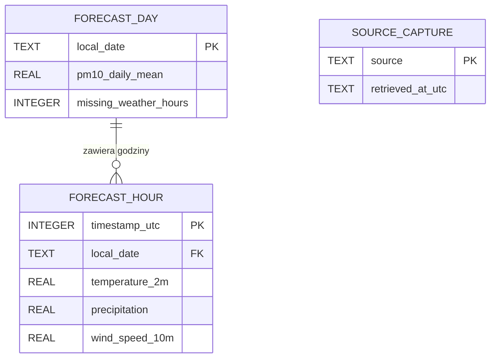

# Model danych SQLite na telefonie

| Tabela | Jeden rekord i zapis |
|---|---|
| `forecast_day` | Lokalna data `YYYY-MM-DD` w `Europe/Warsaw`, dobowe PM10 w µg/m³ albo NULL i licznik brakujących godzin. |
| `forecast_hour` | Jedna godzina prognozy. Znacznik w sekundach Unix UTC jest unikalny. Klucz obcy wskazuje datę lokalną. Wartości temperatury, opadu i wiatru zachowują nazwy i jednostki Lab 3. |
| `source_capture` | Jeden czas pobrania ISO 8601 UTC na źródło `ios_pib_pm10` i `open_meteo`. Oba rekordy opisują bieżący zestaw. |

[DDL](schema.sql) opisuje bazę `aerorun.sqlite3` w pamięci aplikacji na telefonie. Pierwotne pole `date` zapisuje się jako `local_date`, a znacznik `timestamp` z Lab 3 zamienia na UTC. Przy odczycie aplikacja odtwarza offset `Europe/Warsaw`. Braki pozostają NULL.

Po walidacji obu odpowiedzi aplikacja zastępuje poprzednie rekordy trzech tabel w jednej transakcji z włączonymi kluczami obcymi. Usuwa wpisy godzin przed dobami, a przy wstawianiu stosuje odwrotną kolejność. Błąd wycofuje transakcję. Odczyt zapisanego dnia i metadanych odbywa się w jednej transakcji, a podczas obsługi **Sprawdź** aplikacja wykonuje najwyżej jedno odświeżenie naraz. Kod sprawdza datę kalendarzową, skończoność liczb i zgodność doby ze znacznikiem UTC przed zapisem.
